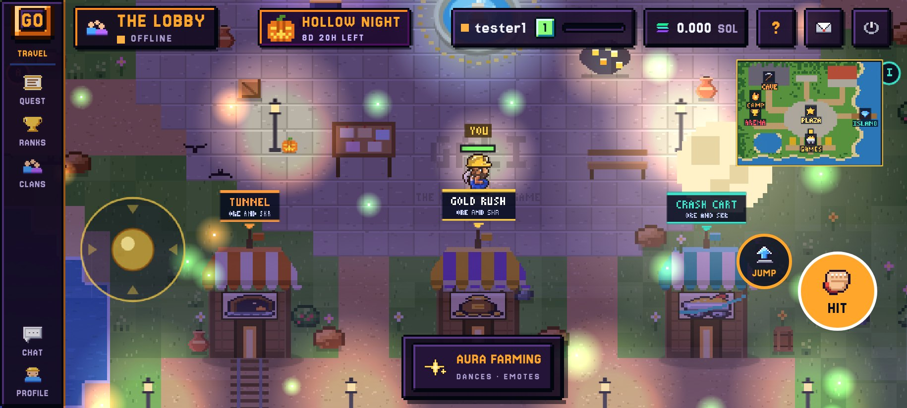
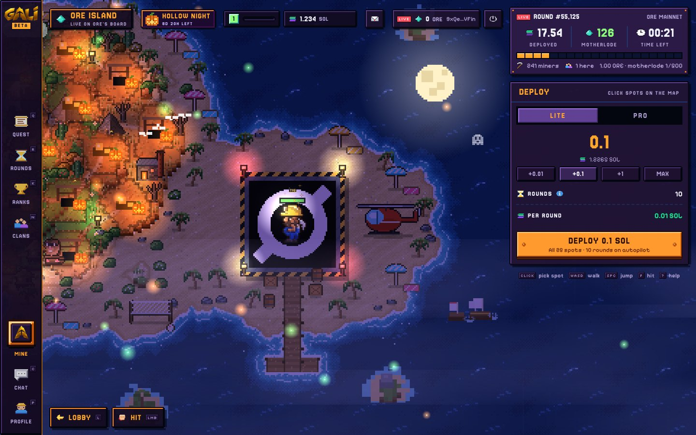

# Gali

**A mini open-world pixel game on Seeker. Mine ORE, play the arcade, brawl with other miners.**

Players meet in a shared pixel town, then walk to ORE Island to mine on [ORE](https://ore.supply)'s own board, the arcade, Cave Run and the Arena.

ORE runs a 25-square mining round every 200 slots (about 80 seconds). Gali draws those 25 squares as spots on a pixel island. Players put SOL on the spots they want. When their spot strikes gold they mine $ORE. ORE keeps a small fee each round and returns the rest of the SOL. 1 round in 500, ORE's motherlode hits.

Submitted to **CLOCK IN** (Solana Mobile) and the **Colosseum Crypto World's Fair**.





- **Official website:** [gali.lol](https://gali.lol)
- **Play live (mainnet BETA):** [galiisland.bounded.page](https://galiisland.bounded.page)
- **Android APK (1.6.0, landscape):** [download from Expo](https://expo.dev/accounts/gali-app/projects/gali/builds/3cd0a6d6-2aaf-41f0-9bf5-3cedeab7c386)
- **Docs:** [galidocs.bounded.page](https://galidocs.bounded.page)
- **Demo video:** [YouTube](https://www.youtube.com/watch?v=PCXDZZQpGm8) (recorded on an earlier build)
- **Founder speech:** [YouTube](https://youtu.be/Fl21Yzhqt_k)
- **Follow Gali on X:** [@Gali_Game](https://x.com/Gali_Game)
- **Team:** [@juntdoe](https://x.com/juntdoe) (technical lead), [@smsonx](https://x.com/smsonx) (BD and spokesperson), [@itsnotajay01](https://x.com/itsnotajay01) (community), [@OO_RAX](https://x.com/OO_RAX) (pixel art and creative)

## Live on mainnet

- **ORE mining.** Connect a wallet at galiisland.bounded.page or in the APK and you play ORE's real board. Each deploy and claim is a plain ORE instruction signed by your own wallet. A round is capped at 0.5 SOL, and an 18+ real-money notice comes before the wallet opens. Deploys and claims have been run with real SOL.
- **Autopilot on ORE's own automation.** Set more than one round and approve once. The wallet funds an ORE `Automation` account and registers a key kept on the device (encrypted with `expo-secure-store`) as its executor. That key can deploy from the automation and nothing else: ORE holds the SOL and pays winnings to the player's miner account. Each round deploys with no pop-up while the app is open. A server runner (`supabase/functions/autopilot`) can keep it going with the app closed; any runner can execute, but none can pick spots, change amounts or move SOL. Autopilot is capped at 1 SOL in total, pays ORE's executor fee at cost (0.00001 SOL per round, the network fee), and STOP returns the unused SOL in one approval.
- **The lobby** is the start screen: a shared pixel town where players walk, chat, emote, dance and tip each other in SOL, ORE or SKR. Doors lead to ORE Island, the arcade, Cave Run and the Arena. Realtime runs on Supabase.
- **The arcade** has three tables (Tunnel Collapse, Gold Rush Pot, Crash Cart) played in ORE or SKR against a funded house wallet. Each 40-second round uses a commit-reveal check players can verify, and the house keeps a 5% fee. 18+ only.

On ORE Island, Gali mints nothing and never holds a player's ORE position, autopilot included. During the beta Gali takes a 0.25% platform fee on SOL deployed, as stated in the docs. The arcade is separate and takes its 5% fee from the tables. ORE is credited here as the board Gali plays on; Gali is not affiliated with or endorsed by ORE.

## Playable, no wager

These are free. They pay miner XP only and never touch SOL, ORE, SKR or mining odds.

- **Cave Run.** Playable, XP only, no wager. Walk your miner through a lantern-lit cave, break rocks, dodge bats and climb deeper.
- **Brawl and the Arena.** Playable, XP only, no wager. Every miner has an HP bar and can hit and jump in the lobby and on the island. The Arena holds up to 12 players in Last Miner Standing, King of the Hill or a co-op Mole King boss. Levels unlock six active powers and two passives, used in the Arena only. Knockouts and wins feed weekly ranks on Supabase.

How it plays: the Android app is landscape, with a joystick on the left and action buttons on the right. The web game is for desktop browsers; phones use the Android app. On a computer, WASD walks, left click hits, right click throws and Q E R C V X fire powers. Chain reads go through a read-only proxy (`app/rpc-backend`) that allows eight RPC methods, with the direct endpoint as a fallback.

## In development (not in this build)

- **The Gali program** (`programs/gali`): points, streaks, an SKR jackpot on ORE's motherlode, gear bought in SKR or ORE, and SKR or ORE staking. It is tested against a mock of ORE's accounts (27 tests) and is not deployed. Its screens (points, streaks, BOOST staking) are hidden in release builds behind `EXPO_PUBLIC_FEATURE_GALI_PROGRAM`, and the app never calls `record_ore_round`. Design and instructions: [ROADMAP.md](ROADMAP.md).
- **Gear as NFTs** and a player Market: planned, not in the app. See [ROADMAP.md](ROADMAP.md).

## Repo layout

| Path | What it is |
| --- | --- |
| `programs/gali` | Anchor program, in development and not deployed: points and streaks read from ORE's rounds, the SKR jackpot, gear in SKR or ORE, staking, session keys, admin |
| `programs/ore-mock` | Test-only stand-in for ORE's program, loaded at ORE's address on a local validator |
| `tests/gali.ts` | Program tests against the mock (27 cases) |
| `app/` | Expo (React Native) app for Android and web. The island is a canvas engine in `app/src/engine` |
| `admin/` | Admin page (Vite + React): balances, token prices, settings, pools, pause, admin hand-over, players, chat moderation |
| `supabase/` | Chat server: tables plus the `chat-post` and `chat-admin` edge functions |
| `scripts/` | Pixel-art generator, devnet deploy and setup, SKR faucet, ORE layout probe, IDL generator, local test runner |
| `video/` | The intro video (9:16 and 16:9), rendered from the real game engine |
| `target/deploy/*.so` | Pre-built programs, so a deploy needs no Rust toolchain. The program keypair is not in git |
| `target/idl/` | Program IDLs (copied to `app/src/chain/idl.json` by `scripts/gen-idl.py`) |

## How a round works

1. **Pick.** LITE: type an amount and Gali spreads it over all 25 spots, 0.01 SOL a spot per round. PRO: pick spots on the map, or take All 25 or Smart (4, 8, 15 or 20 spots at random), and set SOL per round and rounds. Double tap or hold a spot to dive into its mine. Shake the phone to Smart-pick.
2. **Deploy.** One transaction into ORE's board, signed by your wallet. For more than one round, autopilot funds ORE's automation once and a device key deploys each round after that with no pop-up. The key is ORE's executor for that automation: it can deploy, never withdraw.
3. **Strike.** ORE draws one winning square. ORE keeps 1% of every square and 10% of the rest on squares that miss, and returns everything else to the miner who deployed it. Nothing moves from the losing squares to the winners. The winning square mines the round's 1 ORE, split by SOL there. Ten squares a round are solo squares (★): on those, one miner takes the whole ORE, with odds equal to their share.
4. **Motherlode.** ORE adds 0.2 ORE to its motherlode every round and pays the whole pool 1 round in 500, split by SOL on the winning square.

## ORE's account layout

ORE is built with Steel, so there is no IDL or generated client. `app/src/chain/ore/` (and `programs/gali/src/ore.rs`) decode ORE's accounts at offsets checked against live mainnet accounts, and refuse anything with the wrong owner, length or address. Re-run the check after ORE redeploys:

```bash
npx ts-node scripts/ore-probe.ts
```

## Run it

### App (mainnet)

Needs Node 22+.

```bash
cd app
npm install --legacy-peer-deps
EXPO_PUBLIC_NETWORK=mainnet npx expo start --web
```

Tests: `npm test` runs the app's node suites (wallet safety, live clock, poll budget, lobby, lobby networking, Cave Run, Brawl, the Arena, the arcade server, the read proxy). No wallet or network needed.

Feature flags (see `app/.env.example`): `EXPO_PUBLIC_FEATURE_GALI_PROGRAM=1` shows the Gali program's screens (points, streaks, BOOST staking) for a local or test build. It is off by default and must stay off in release builds until the program is deployed.

Release APK: `npx eas-cli build -p android --profile apk-live`. Web build: `EXPO_PUBLIC_NETWORK=mainnet npm run build:web` writes `app/dist`, a static site.

The app reads ORE's board clock every 10 seconds and counts down locally in between. Set `EXPO_PUBLIC_RPC_READ_URL` to a deployed read proxy (`app/rpc-backend`) so no RPC key ships in the app. `EXPO_PUBLIC_RPC_URL` is the direct endpoint for sending transactions and for fallback reads; anything in it is public, so never put a secret key there.

### Program tests

Needs the Solana CLI 2.1.21 and Node 20+. Anchor is optional.

```bash
npm ci
cargo-build-sbf --manifest-path programs/gali/Cargo.toml
cargo-build-sbf --manifest-path programs/ore-mock/Cargo.toml
bash scripts/test-local.sh
```

`test-local.sh` starts a local validator with `ore-mock` at ORE's address and Gali as an upgradeable program, then runs the 27 tests. The `program` GitHub workflow does the same on every change to the programs, and the `ci` workflow type-checks, tests and builds the app and the admin page.

### Devnet deploy

Needs the Solana CLI, Node 20+, `target/deploy/gali-keypair.json` and about 4.5 devnet SOL in `~/.config/solana/id.json`.

```bash
bash scripts/deploy-devnet.sh
ADMIN=<wallet> bash scripts/deploy-devnet.sh    # make another wallet the admin
```

It deploys or upgrades the program, creates mock SKR and ORE mints (devnet has no ORE), initialises the config and writes `app/src/chain/deployment.json`. Options: `SKR_MINT`, `ORE_MINT`, `ORE_USD`, `PRICE_MAX_AGE_SECS`, `MOTHERLODE_SEED`, `ORE_SEED`. Send test SKR with `npx ts-node scripts/faucet.ts <wallet> 50000`.

### Admin page

```bash
cd admin
cp .env.example .env            # set VITE_RPC_URL
npm install
npm run dev
```

Connect the admin wallet to make changes; any other wallet gets a read-only view. It is a static site, so `admin/dist` can go on any static host.

### Chat server (Supabase)

```bash
supabase link --project-ref <ref>
supabase db push
supabase secrets set SKR_MINT=<mint> GALI_PROGRAM_ID=GamTh2wWNNGU6CB5G3aF7Xeu1m7fQEtd9caRGtgPcMmV
supabase functions deploy chat-post --no-verify-jwt
supabase functions deploy chat-admin --no-verify-jwt
```

Then put the project URL and anon key in `app/src/chain/chat.json`. The same project carries the lobby: positions, emotes, dances, tips and lobby chat travel over Realtime broadcast (`app/src/game/lobby.ts`), throttled to stay under the free plan's message cap. The `chat-post` function is the signed path for the Gali program: it checks each message against the player's session key on the on-chain Player account.

## Pixel art

Every sprite is original and drawn in code. `python3 scripts/pixel-art.py` rebuilds the island, miners, gear, pets, props and the 3x5 bitmap font into one 1024x512 atlas (`app/public/pixel/atlas.png`, `app/src/engine/art.json`).

## Known limitations

- The Gali program has run against `ore-mock` only, not ORE's live program yet. The app's ORE client runs live on mainnet.
- Points, the SKR jackpot, staking and on-chain gear arrive with the Gali program. Mining and autopilot do not need it.
- Token rates are set by the admin, not an oracle. Use a multisig as admin and a published change policy before real money.
- `init_player` grants the starter pickaxe only. The free starter helmet and outfit exist in the app but cannot be claimed on chain yet.
- It is a game of chance with real SOL. A real-money launch needs age gating and a legal review per market.

## Security notes

We ran an automated security review on commit `0c13d2a`. It confirmed no defect in Gali's own code. What it raised, and where we stand:

- **Supabase key in the app.** `world.ts` and `chat.json` read the Supabase anon key, which is public by design. The chat tables have row level security on, with read-only policies, so writes go through the `chat-post` and `chat-admin` edge functions only.
- **Program checks.** ORE accounts are refused unless the owner, length and address match (`programs/gali/src/ore.rs`). The admin hand-over needs the new wallet to sign, and unstaking cannot take more than was staked. `record_ore_round` is open to anyone on purpose.
- **Sanity checks on ORE's bytes.** A round whose `expires_at` sits more than 3 days of slots from the current slot, or whose motherlode is above ORE's 3,000,000 max supply, fails with `BadOreLayout`. If ORE moves a field, Gali stops instead of paying from a misread value.
- **Input checks.** `init_config` refuses a zero SKR or ORE rate, and `set_session` refuses a session that has already expired. `claim_jackpot` creates the winner's SKR and ORE token accounts if they are missing, so a hit is never lost to a missing account.
- **npm advisories.** `toml`, `bigint-buffer`, `stream-json` and `uuid` arrive through `@coral-xyz/anchor`, `@solana/spl-token` and `@solana/web3.js`. None has an upstream fix yet; npm's suggested fix is a downgrade that breaks the app. We will update when those libraries ship fixes. `serialize-javascript` comes in through `mocha` and runs in tests only.
- **Token rates.** SKR and ORE rates are set by the admin, not an oracle. Before real money, the admin should be a multisig and `price_max_age_secs` should be set above 0 so stale rates are refused.

## License

MIT, see [LICENSE](LICENSE).
