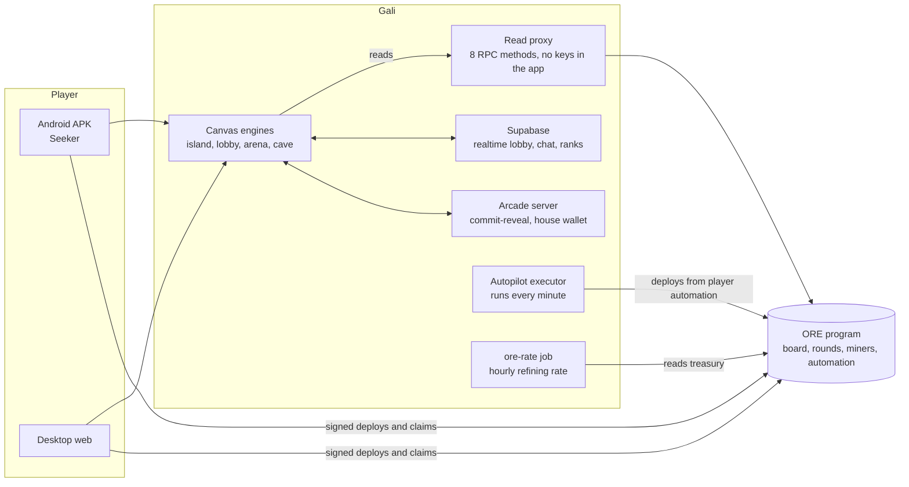

<div align="center">

# GALI

### Mining ORE should feel like a game. Now it does.

**A pixel open world on Solana Seeker, built on top of ORE's live mining board.**
Walk into a shared town and ride a mine cart around it. Head to the island and deploy SOL on real ORE rounds. Stay for the arcade, the Arena and the people.

[](https://galiisland.bounded.page)
[](https://expo.dev/accounts/gali-app/projects/gali/builds/3cd0a6d6-2aaf-41f0-9bf5-3cedeab7c386)
[](https://ore.supply)
[](LICENSE)

**[Play on desktop](https://galiisland.bounded.page)** · **[Android APK](https://expo.dev/accounts/gali-app/projects/gali/builds/3cd0a6d6-2aaf-41f0-9bf5-3cedeab7c386)** · **[gali.lol](https://gali.lol)** · **[Docs](https://galidocs.bounded.page)** · **[Demo video](https://www.youtube.com/watch?v=PCXDZZQpGm8)** · **[@Gali_Game](https://x.com/Gali_Game)**

Submitted to **CLOCK IN** (Solana Mobile) and the **Colosseum Crypto World's Fair**.

</div>


---

## The problem

[ORE](https://ore.supply) is a mining game on Solana: a 25-square round every 200 slots, about 80 seconds. Its board is pure numbers. You pick squares, you wait, you check a table.

That works for traders. It does not keep a casual player coming back, and it has nothing to do between rounds.

## What Gali does

Gali turns that board into a place.

- **The 25 squares become 25 spots on a pixel island.** You walk your miner there, pick spots and watch the strike land.
- **Every deploy is a real ORE transaction,** signed by your own wallet. Gali never holds your SOL or your ORE.
- **Between rounds there is a world.** A shared town holds up to 100 players with chat, emotes, dances and tips in SOL, ORE or SKR. Ride carts and scooters, play three arcade tables, fight in the Arena or dig in the cave.

The result: the same ORE round, with a reason to stay for the next one.


---

## Try it in 60 seconds

1. Open **[galiisland.bounded.page](https://galiisland.bounded.page)** in a desktop browser, or install the **[Android APK](https://expo.dev/accounts/gali-app/projects/gali/builds/3cd0a6d6-2aaf-41f0-9bf5-3cedeab7c386)** on a Seeker.
2. Connect a Solana wallet and pick a miner name.
3. Walk down the pier (or tap **GO → ORE ISLAND**).
4. In **LITE**, tap **+0.01** and **DEPLOY**. That is one round of 0.01 SOL across all 25 spots, on mainnet.
5. While it runs, go back to the lobby, hop on a cart with **E** and say hi.

This is real SOL on mainnet. Rounds are capped at 0.5 SOL during the beta, and an 18+ notice shows before any wallet opens.

---

## What is live today

| | Feature | What it does | On chain |
|---|---|---|---|
| **Mine** | ORE Island, Lite and Pro | Lite turns an amount into rounds across all 25 spots, like ORE's own Lite. Pro lets you pick spots, SOL per round and rounds. | Yes, ORE's board |
| | Autopilot | One approval funds ORE's own automation. Rounds keep playing with the game closed, run by a server executor that can deploy but never withdraw. STOP returns unused SOL. | Yes, ORE automation |
| | Claims and the hold reminder | Claim returned SOL and mined ORE. A pop-up reminds you that holding unrefined ORE earns a share of the 10% other miners pay to claim. | Yes |
| | ORE Stats panel | Desktop: your all-time ORE, unrefined, refined and refined gained in 24 hours, plus all Gali miners combined. | Reads ORE |
| **Play** | The lobby | A shared pixel town for up to 100 players: walk, chat, stickers, 12 dances, emotes, tips. | Tips are real transfers |
| | Carts and scooters | Public rides all over the lobby. Anyone can take one, and it stays where you leave it for everyone. | No |
| | Arcade | Tunnel Collapse, Gold Rush Pot and Crash Cart, played in ORE or SKR against a funded house. 40-second rounds with a commit-reveal draw anyone can verify. 18+. | Yes, SPL transfers |
| | Brawl and the Arena | HP bars and KOs anywhere in town. The Arena hosts up to 12 players in Last Miner Standing, King of the Hill or a co-op Mole King boss. Levels unlock powers. | No, XP only |
| | Cave Run | A lantern-lit dig with a joystick and a pickaxe. Rocks, bats, gems, deeper floors. | No, XP only |
| **Live ops** | Seasons | Hollow Night runs 24 Oct to 5 Nov: a dark island, fog, bats, ghosts and glowing pumpkins. Looks only, never odds. | No |
| | Sound | 8-bit music for every place, a voiced announcer and miner barks, all made for Gali. | No |
| | Quests, levels and ranks | Nine daily quests, achievements, one XP bar across mining and fighting, boards for today, month, year and all time. | Reads ORE for ORE ranks |

Brawl, the Arena and Cave Run never touch SOL, ORE, SKR or mining odds. They exist to make the town fun between rounds.

---

## Why Seeker

- **Real game controls.** The APK plays sideways with a joystick on the left and HIT, JUMP and RIDE on the right.
- **Mobile Wallet Adapter and Seed Vault.** Deploys and claims are signed on the phone with no browser extension.
- **SKR is a first-class token.** Stake it on arcade tables and tip it to other miners.
- **Short sessions that fit a phone.** One ORE round is about 80 seconds. Autopilot carries on after you lock the screen.

---

## How a round works

1. **Pick.** Lite turns your amount into rounds of 0.01 SOL, each spread over all 25 spots. Pro lets you pick spots on the map, or take All 25 or Smart (4, 8, 15 or 20 at random).
2. **Deploy.** One transaction into ORE's board, signed by your wallet. More than one round funds ORE's automation once; an executor then deploys each round with no pop-up.
3. **Strike.** ORE draws one winning square. It keeps 1% of every square plus 10% of the rest on squares that miss, and returns everything else. The winning square mines the round's 1 ORE, split by SOL there. On the round's 10 solo squares (★) one miner takes it all, with odds equal to their share.
4. **Motherlode.** ORE adds 0.2 ORE to its motherlode every round and pays the whole pool 1 round in 500.

Gali shows each round's result in a strike pop-up, including small ORE wins down to a millionth of an ORE.

---

## Architecture



- **Non-custodial by design.** Deploys and claims are plain ORE instructions signed by the player. Autopilot uses ORE's own `Automation` account: the executor can deploy from it and nothing else.
- **No secrets in the client.** Chain reads go through a read-only proxy (`app/rpc-backend`) with an allow-list of eight methods. RPC keys stay on the server.
- **ORE decoded by hand.** ORE is built with Steel, with no IDL. `app/src/chain/ore/` decodes its accounts at offsets checked against live mainnet data and refuses anything with the wrong owner, length or address.
- **Realtime that fits a free tier.** Lobby positions travel twice a second over Supabase broadcast. Each one carries where the player is heading, so others walk smoothly in between. A ride costs one message to get on and one to get off; riding itself adds none.
- **Every sprite is drawn in code.** `scripts/pixel-art.py` rebuilds the island, miners, gear, pets, props and the bitmap font into one atlas. Rides and seasonal props are code-drawn too.

---

## Built to be trusted

| | |
|---|---|
| **17 app test suites** | Wallet safety, live clock, poll budget, lobby and its networking, rides, Brawl, the Arena, Cave Run, the arcade server and the read proxy. `cd app && npm test`, no wallet or network needed. |
| **27 program tests** | `programs/gali` against `programs/ore-mock` at ORE's address on a local validator. |
| **CI on every push** | Type checks, all suites, Android and web builds, dependency checks and a secret scan over the source and the built bundles. |
| **Round caps** | 0.5 SOL a round and 1 SOL per autopilot during the beta. |
| **Verifiable arcade** | The house publishes a hash before each round and the secret after it, so anyone can check the draw. |
| **Safe failure** | If ORE moves a field, Gali stops instead of paying from a misread value. |

---

## Business model

- **ORE mining:** a 0.25% platform fee on SOL deployed during the beta, stated in the [docs](https://galidocs.bounded.page). It goes to a fixed revenue wallet in the same transaction. Gali never takes a cut of winnings.
- **Arcade:** a 5% house fee on Tunnel Collapse and Gold Rush Pot, and a house edge on Crash Cart.
- **Next:** cosmetic gear as NFTs with resale royalties (see the roadmap).

---

## Roadmap

| Stage | What |
|---|---|
| **Now** | Mainnet beta on desktop web and Android. Weekly APK releases from tester feedback. APK 1.7 lands this week. |
| **In development** | The Gali program (`programs/gali`): points, streaks, an SKR jackpot on ORE's motherlode, gear and staking. Tested against a mock of ORE, not deployed; its screens are hidden behind `EXPO_PUBLIC_FEATURE_GALI_PROGRAM`. A Gali app for Android TV (`tv/`) that pairs with a Seeker. One-tap Seeker Connect. |
| **Planned** | Gear as tradeable NFTs and a player Market. Clans. More seasons. |

Details in [ROADMAP.md](ROADMAP.md).

---

## Team

| | |
|---|---|
| [@juntdoe](https://x.com/juntdoe) | Technical lead |
| [@smsonx](https://x.com/smsonx) | BD and spokesperson |
| [@itsnotajay01](https://x.com/itsnotajay01) | Community |
| [@OO_RAX](https://x.com/OO_RAX) | Pixel art and creative |

Founder speech: [YouTube](https://youtu.be/Fl21Yzhqt_k).

ORE is credited as the board Gali plays on. Gali is not affiliated with or endorsed by ORE.

---

## For builders

### Repo layout

| Path | What it is |
| --- | --- |
| `app/` | Expo (React Native) app for Android and web. Canvas engines in `app/src/engine`, game state in `app/src/game`, chain code in `app/src/chain` |
| `app/rpc-backend/` | Read proxy and the arcade server (`functions/games.mjs`) |
| `supabase/` | Edge functions (`autopilot`, `ore-rate`, `dm`, chat) and SQL for chat, ranks, autopilot and ORE stats |
| `programs/gali` | Anchor program, in development and not deployed |
| `programs/ore-mock` | Test-only stand-in for ORE's program |
| `tests/gali.ts` | Program tests against the mock (27 cases) |
| `admin/` | Admin page (Vite + React) |
| `tv/` | Android TV app, in development |
| `scripts/` | Pixel-art generator, ORE layout probe, devnet deploy, local test runner |
| `video/` | The intro video, rendered from the real game engine |

### Run the app

Needs Node 22+.

```bash
cd app
npm install --legacy-peer-deps
EXPO_PUBLIC_NETWORK=mainnet npx expo start --web
npm test
```

Set `EXPO_PUBLIC_RPC_READ_URL` to a deployed read proxy so no RPC key ships in the app. `EXPO_PUBLIC_RPC_URL` is public; never put a secret there. Feature flags live in `app/.env.example`.

Release APK: `npx eas-cli build -p android --profile apk-live`. Web build: `EXPO_PUBLIC_NETWORK=mainnet npm run build:web`.

### Program tests

Needs the Solana CLI 2.1.21 and Node 20+.

```bash
npm ci
cargo-build-sbf --manifest-path programs/gali/Cargo.toml
cargo-build-sbf --manifest-path programs/ore-mock/Cargo.toml
bash scripts/test-local.sh
```

### Supabase

The lobby, chat and ranks run on one Supabase project. SQL lives in `supabase/sql/`; each file says what to replace (`<PROJECT_REF>`, `<CRON_SECRET>`) and what to run first. Store the cron key in Supabase Vault, never in a file. Edge functions deploy with `supabase functions deploy <name> --no-verify-jwt`; each one checks its own secret.

### Check ORE's layout

```bash
npx ts-node scripts/ore-probe.ts
```

Re-run it after ORE redeploys.

---

## Known limitations

- The Gali program has run against `ore-mock` only. Mining, autopilot and claims use ORE's live program and do not need it.
- Lifetime refined ORE is not shown: ORE resets refined ORE on claim and keeps no history.
- The all-Gali ORE total adds each wallet's lifetime ORE, which includes ORE mined outside Gali.
- It is a game of chance with real SOL. A public launch needs age gating and a legal review per market.

## Security notes

- **Supabase key in the app** is the public anon key, by design. Tables have row level security on, and signed reports for ranks and chat are rolling out.
- **ORE account checks** refuse wrong owners, lengths or addresses, and sanity-check fields so a layout change stops Gali instead of misreading.
- **npm advisories** in `toml`, `bigint-buffer`, `stream-json` and `uuid` arrive through Solana libraries with no upstream fix yet. We will update when they ship.

## License

MIT, see [LICENSE](LICENSE).
